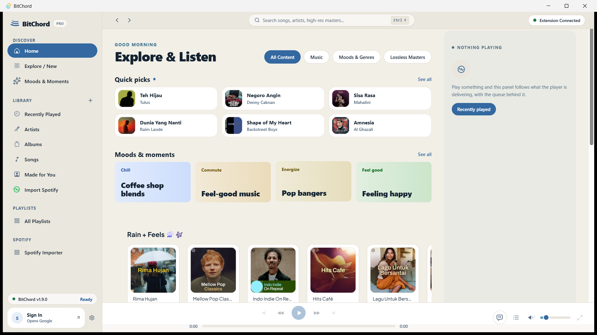
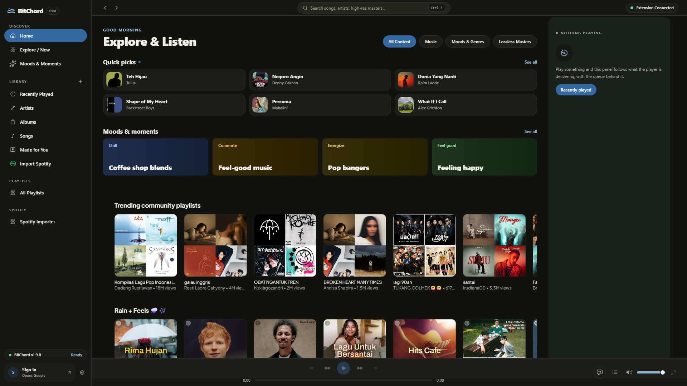
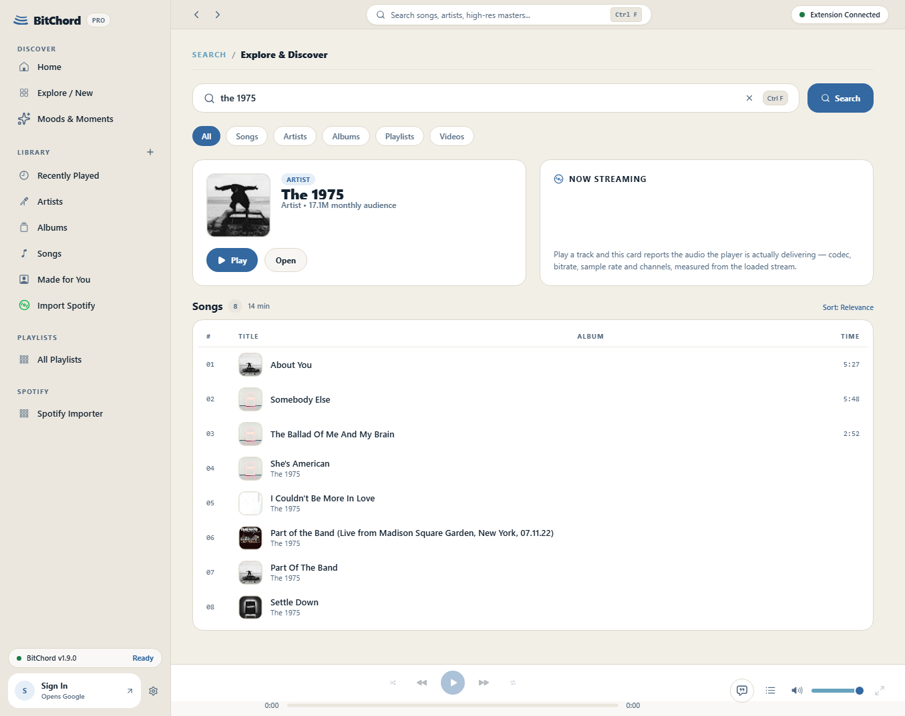
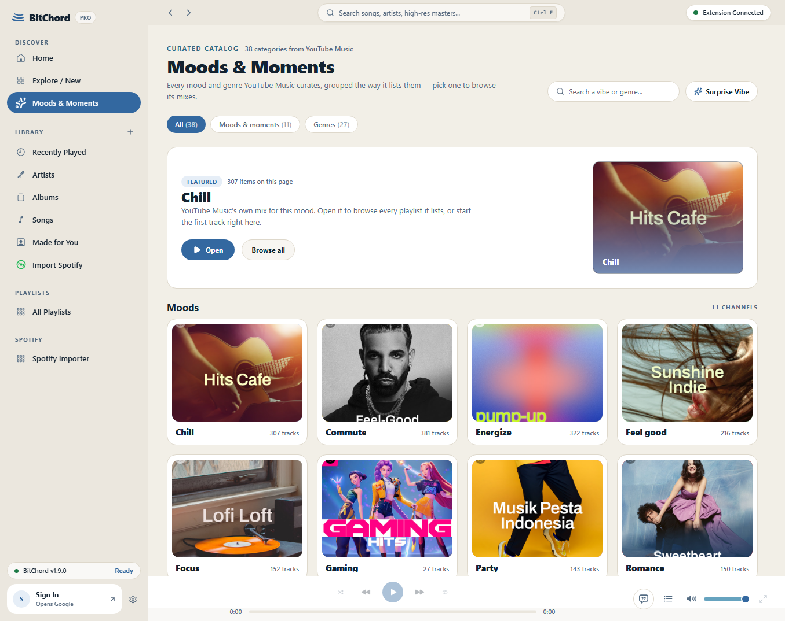
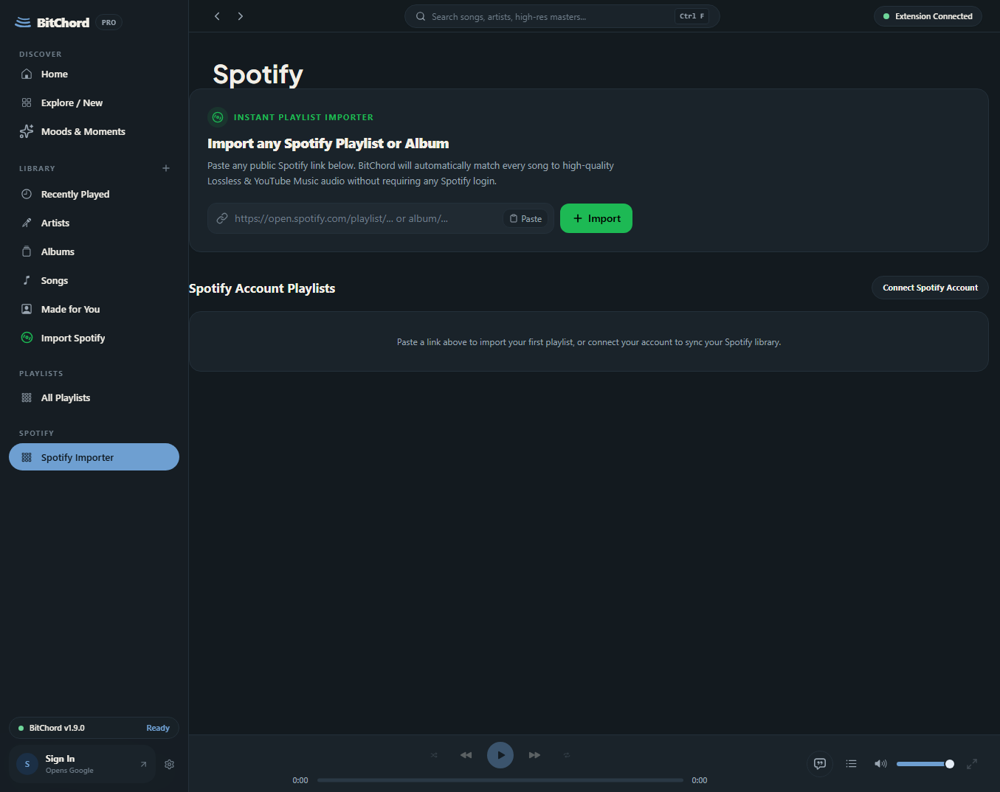
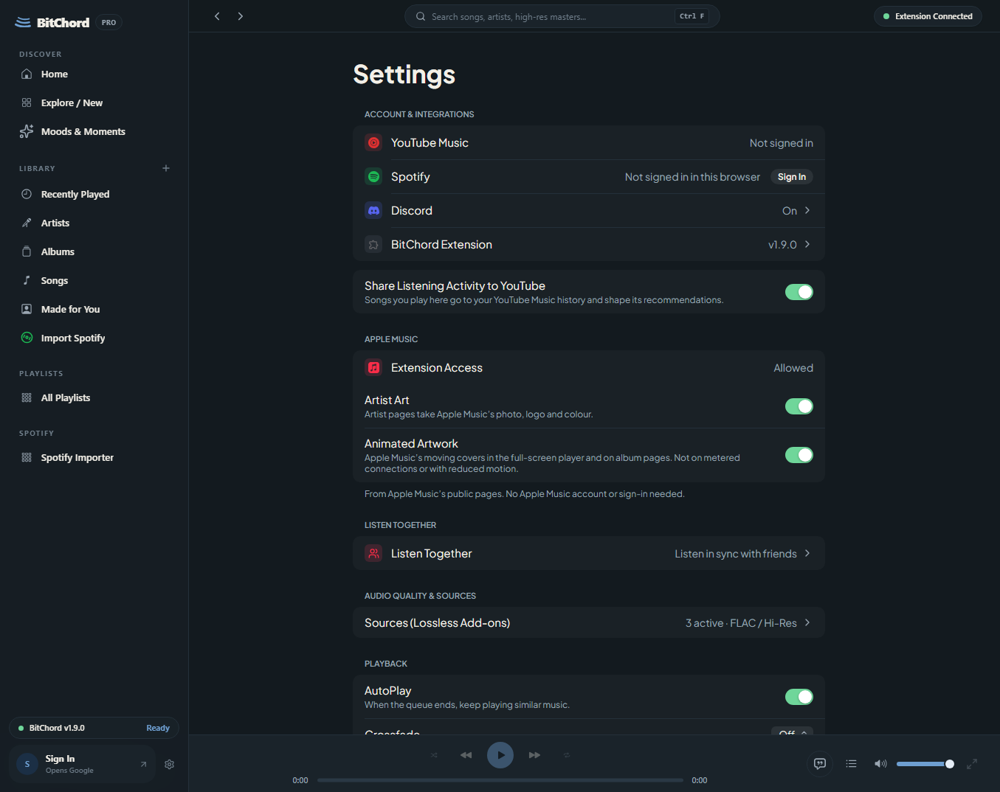

<div align="center">


# BitChord Desktop

### Native Tauri v2 Music Client — YouTube Music Lossless/Hi-Res, Spotify Importer & Cross-Device Listen Together

[](LICENSE)
[](https://v2.tauri.app/)
[](https://www.rust-lang.org/)
[](https://react.dev/)

[**Perubahan dari Upstream**](#-perubahan-utama-dari-upstream) · [**Fitur Baru**](#-penambahan-fitur) · [**Screenshots**](#-screenshots-aplikasi) · [**Tech Stack**](#-tech-stack) · [**Struktur Repo**](#-struktur-direktori) · [**Build Lokal**](#-cara-menjalankan--build-lokal)

</div>

> [!IMPORTANT]
> **BitChord Desktop** (`Pinn-Bitchord`) adalah pengembangan dan evolusi desktop dari repositori upstream [kushagrasinghx/BitChord](https://github.com/kushagrasinghx/BitChord). Aplikasi ini tidak berafiliasi dengan Google LLC, YouTube Music, maupun Spotify AB.

---

## 📸 Screenshots Aplikasi

| **Home Dashboard — Light Ceramic & Frosted Sage** | **Home Dashboard — Dark Ceramic** |
| :---: | :---: |
|  |  |

| **Search & Instant Discovery** | **Moods & Moments Hub** |
| :---: | :---: |
|  |  |

| **Spotify Playlist Importer (No API Key)** | **Settings & Native Integrations** |
| :---: | :---: |
|  |  |

---

## 🔄 Perubahan Utama dari Upstream

Dibandingkan repositori asli [kushagrasinghx/BitChord](https://github.com/kushagrasinghx/BitChord) (yang berfokus pada Android/KMP + Web Player berbasis ekstensi browser), versi ini membawa perombakan arsitektur dan UI untuk pengalaman desktop Windows yang mandiri:

1. **Desktop Native Shell Berbasis Tauri v2 (Rust)** — [`web/src-tauri/`](web/src-tauri/)
   - Mengemas frontend web player menjadi aplikasi desktop Windows native (`BitChord.exe` / WebView2) yang berdiri sendiri tanpa perlu memasang ekstensi browser terpisah.
   - Mendukung **System Tray** (minimize ke tray saat jendela ditutup) dan **Single-Instance Guard** (`tauri-plugin-single-instance`).
   - **Optimasi Memori RAM (*Working Set Trimming*)**: Memanggil API Windows `SetProcessWorkingSetSize` secara periodik dan saat diminimalkan di [`lib.rs`](web/src-tauri/src/lib.rs) untuk menekan penggunaan RAM WebView2 secara signifikan.

2. **Native Rust HTTP & Auth Bridge** — [`web/src-tauri/src/bridge.rs`](web/src-tauri/src/bridge.rs)
   - Menyediakan command IPC (`bridge_http`, `bridge_ping`, `bridge_auth_state`) menggunakan `reqwest` + `rustls-tls` untuk menangani request YouTube Music InnerTube dan Google Video stream langsung dari Rust (bebas kendala CORS browser).

3. **Redesign UI/UX "Light Ceramic & Frosted Sage" + Theme Switcher** — [`tokens.css`](web/app/src/styles/tokens.css)
   - Mengubah antarmuka menjadi palet editorial yang bersih dan terkalibrasi kontrasnya:
     - Kanvas **Alabaster Ceramic** (`#F2EFE7`), kartu **Porcelain** (`#FFFFFF`), sidebar **Chrome** (`#EAE6DD`), panel inspector **Frosted Sage** (`#E8EAE3`), aksen **Slate Blue** (`#3368A0`), dan teks utama **Deep Slate Navy** (`#132230`).
   - **Theme Switcher (`Light` / `Dark` / `System`)** di [`theme.ts`](web/app/src/lib/theme.ts) dan Settings → Appearance (default **Light Ceramic**, bebas kedip sebelum render pertama di [`index.html`](web/app/index.html)).
   - **Perbaikan Kontras Panel Lirik (`SidePanel` & `LyricsPanel`)**: Menyuntikkan stylesheet Shadow DOM ter-scope (`:host(:not([data-full]))`) pada komponen `<am-lyrics>` sehingga teks lirik aktif/non-aktif tampil tajam pada panel terang, sambil mempertahankan mode gelap pada fullscreen player.
   - **Perbaikan Kontras Halaman Playlist & Album (`[data-tint]`)**: Mengunci token warna teks light mode pada `tokens.css`, `DetailHeader.tsx`, dan `TrackList.tsx` agar judul playlist/lagu tetap kontras di atas kartu porcelain meskipun cover artwork berwarna gelap.
   - **Pembenahan Layout Shell (`AppShell.tsx`, `DesktopHeader.tsx`, `PlayerBar.tsx`)**: Memisahkan `PlayerBar` ke baris grid tersendiri agar tidak tertutup sidebar, serta menampilkan status codec/bitrate dan shortcut pencarian (`Ctrl+F` / `/`) sesuai fungsi aslinya.

4. **Transport Native Rust untuk Listen Together** — [`web/src-tauri/src/party.rs`](web/src-tauri/src/party.rs) & [`nativeTransport.ts`](web/app/src/party/nativeTransport.ts)
   - WebView2 selalu mengirim header `Origin: http://tauri.localhost` yang ditolak allowlist server party dengan `403`. Transport HTTP & WebSocket dipindahkan ke Rust (`reqwest` + `tokio-tungstenite` dengan header `Authorization: Bearer <token>`), sehingga desktop langsung terhubung ke server Listen Together bersama perangkat Android tanpa perlu deploy server khusus.

---

## ✨ Penambahan Fitur

- **🎧 Spotify Playlist & Album Importer Tanpa API Key** ([`importer.ts`](web/app/src/data/spotify/importer.ts), [`SpotifyImportModal.tsx`](web/app/src/components/music/SpotifyImportModal.tsx))
  - Tempel URL publik Spotify untuk mengambil daftar lagu dari metadata embed (`__NEXT_DATA__`), lalu dicocokkan secara otomatis (*batch fuzzy matching* di [`trackMatcher.ts`](web/app/src/data/match/trackMatcher.ts)) ke stream audio YouTube Music — termasuk auto-matching di latar belakang pada [`PlaylistPage.tsx`](web/app/src/pages/PlaylistPage.tsx).
- **💾 Local Library & Offline Persistence** ([`localPlaylists.ts`](web/app/src/data/music/localPlaylists.ts), [`localFavorites.ts`](web/app/src/data/music/localFavorites.ts))
  - Buat playlist lokal, simpan hasil impor Spotify, dan kelola lagu favorit secara lokal (`localStorage`) tanpa wajib login akun Google/YouTube.
- **🎮 Discord Rich Presence via Native IPC Pipe** ([`discord.rs`](web/src-tauri/src/discord.rs), [`DiscordSettingsPage.tsx`](web/app/src/pages/DiscordSettingsPage.tsx))
  - Mendeteksi langsung named pipe aplikasi Discord desktop (`\\.\pipe\discord-ipc-*`), mengirim status lagu, artis, artwork, dan progress bar secara aman tanpa perlu menyalin token akun Discord.
- **🔊 Listen Together Lintas Perangkat (Desktop ↔ Android)** ([`ListenTogetherPage.tsx`](web/app/src/pages/ListenTogetherPage.tsx), [`backend/`](backend/), [`app/`](app/))
  - **Join/Start Party Tanpa Login YouTube**: Desktop tanpa akun YT Music tetap bisa membuat atau bergabung ke party menggunakan identitas device (`sha256(deviceId)`).
  - **Toggle "Play on this device"**: Tersedia di Desktop (gain gate Web Audio) dan Android (`PartyMute` di ujung DSP/`BitPerfectAudioSink`) untuk membisukan suara di perangkat tertentu tanpa memutus sinkronisasi antrean maupun kontrol party.
  - **Host Per-Member Volume Control**: Host party dapat mengatur slider volume masing-masing pendengar atau meresetnya kembali ke volume bawaan perangkat.
- **⏱️ Sleep Timer, Stream Quality Selector & Stats for Nerds** ([`SleepTimerPicker.tsx`](web/app/src/playback/SleepTimerPicker.tsx), [`StreamQuality.tsx`](web/app/src/shell/StreamQuality.tsx), [`NerdStats.tsx`](web/app/src/shell/NerdStats.tsx))
  - Memantau detail teknis real-time dari stream aktif (`codec`, `sampleRateHz`, `bitrateKbps`, `channels`, `itag`, `client`, `mode`).

---

## 🛠️ Tech Stack

| Layer | Teknologi & Library |
|---|---|
| **Desktop Shell & Backend Native** | [Tauri v2](https://v2.tauri.app/) (`2.12.5`), Rust (`edition = "2024"`), Microsoft Edge WebView2, `reqwest` (`rustls-tls`), `tokio`, `tokio-tungstenite`, Windows API (`SetProcessWorkingSetSize`) |
| **Frontend UI** | [React 19](https://react.dev/), TypeScript, [Vite 8](https://vite.dev/), [Tailwind CSS v4](https://tailwindcss.com/), React Router, [Lucide Icons](https://lucide.dev/), Plus Jakarta Sans |
| **State & Data Fetching** | [Zustand v5](https://zustand-demo.pmnd.rs/), [TanStack React Query v5](https://tanstack.com/query), TanStack React Virtual, IndexedDB (`idb`) |
| **Audio Engine, DSP & Lirik** | `youtubei.js` (InnerTube), `shaka-player` (SABR/ABR), `hls.js`, `essentia.js` + `onnxruntime-web` (automix beat/key analysis), `signalsmith-stretch`, `@uimaxbai/am-lyrics` |
| **Companion Modules (Upstream Sync)** | **Android / TV / WearOS**: Kotlin, Jetpack Compose, ExoPlayer/Media3, Gradle (`app/`, `tv/`, `wearos/`, `shared/`, `sharedUi/`) · **Party Server**: Go (`backend/`) |
| **Tooling & Testing** | `pnpm` Workspaces (`pnpm@12.15.0`), Node.js `>=22`, Vitest, Cargo |

---

## 📂 Struktur Direktori

```text
BitChord_PC/
├── web/
│   ├── app/                  # Frontend React + Vite + Tailwind v4 (UI Light/Dark Ceramic, player, Spotify importer)
│   ├── src-tauri/            # Backend native Rust & Tauri v2 (HTTP bridge, Discord IPC, Listen Together WS, tray, RAM trim)
│   ├── shared/               # Protokol RPC TypeScript antara UI, Tauri IPC, dan Extension
│   ├── extension/            # Browser companion extension (Chrome/Firefox via WXT)
│   └── docs/                 # Catatan teknis internal (playback, automix, lyrics, dll.)
├── app/                      # Aplikasi Android (Kotlin / Jetpack Compose + sinkronisasi fitur Listen Together)
├── backend/                  # Server Listen Together berbahasa Go (WebSocket & REST)
├── shared/ & sharedUi/       # Modul Kotlin Multiplatform (KMP) dari upstream
├── tv/ & wearos/             # Target companion Android TV & Wear OS dari upstream
└── docs/screenshots/         # Screenshot aplikasi desktop untuk dokumentasi
```

---

## 🚀 Cara Menjalankan & Build Lokal

### Prasyarat
- **Node.js** `>= 22` & **pnpm** (`corepack enable`)
- **Rust Toolchain** (MSVC x64 target di Windows) & **Microsoft Edge WebView2 Runtime**

### 1. Install Dependensi
```powershell
cd web
pnpm install
```

### 2. Menjalankan Mode Development
```powershell
# Menjalankan frontend Vite dev server
pnpm --filter @bitchord/app dev

# Atau menjalankan aplikasi desktop Tauri dalam mode dev
pnpm exec tauri dev
```

### 3. Typecheck, Unit Test & Build Production Standalone
```powershell
# Cek TypeScript dan jalankan unit test frontend
pnpm -r typecheck
pnpm -r test

# Build production frontend (@bitchord/app)
pnpm --filter @bitchord/app build

# Kompilasi executable standalone Windows (.exe tanpa installer)
pnpm exec tauri build --no-bundle
```
Hasil executable release akan berada di `web/src-tauri/target/release/bitchord.exe` (beserta `WebView2Loader.dll` jika didistribusikan sebagai paket portabel).

---

## 🙏 Credits & Lisensi

- **Upstream Project:** [kushagrasinghx/BitChord](https://github.com/kushagrasinghx/BitChord) — Arsitektur dasar player, Kotlin Multiplatform core, dan backend Listen Together.
- **Lyrics Engine:** [binimum/am-lyrics](https://github.com/binimum/am-lyrics) / `@uimaxbai/am-lyrics`.
- **Lisensi:** Proyek ini dirilis di bawah lisensi **GNU General Public License v3.0 (GPLv3)**. Lihat file [`LICENSE`](LICENSE) untuk detail lengkap.
